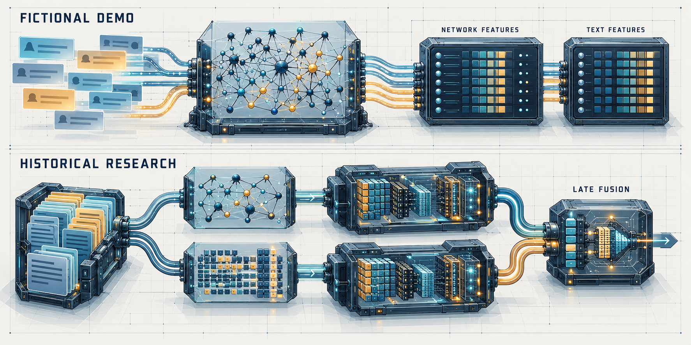
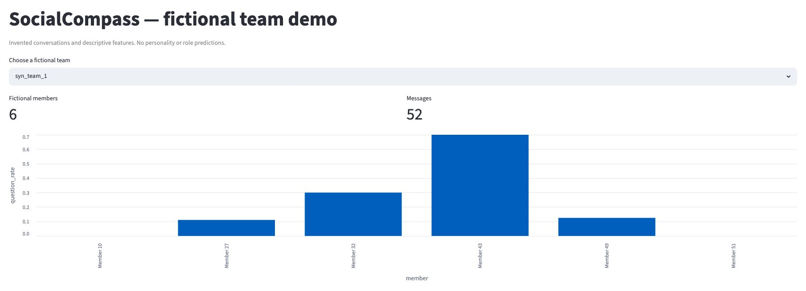
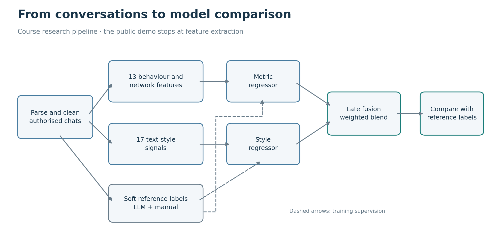
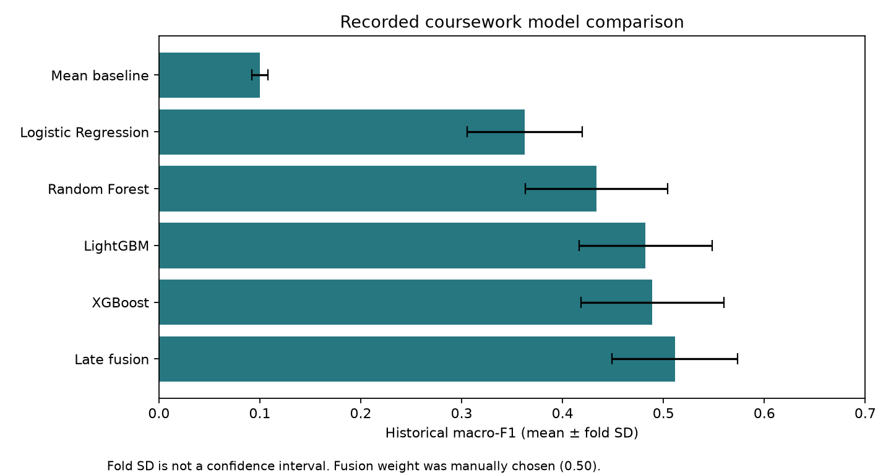

# SocialCompass — Team Communication Analysis with NLP and Networks



*Technical concept illustration of the fictional feature-extraction demo and the separate historical research workflow; no real messages or results are shown.*

[](https://github.com/kasra-mohebian/team-communication-analyzer/actions/workflows/tests.yml)

SocialCompass was a collaborative university project exploring a practical question: **what can message text and interaction patterns tell us about communication in a team?** It combined chat parsing, NLP features, inferred networks and weakly supervised models.

The course project is complete. This public edition preserves its implementation and selected historical results, with a fictional-data demo that can be inspected without private conversations or API access.

## A look at the demo



*An actual run of the public demo. The members and messages are invented; the chart shows descriptive features, not role or personality predictions.*

## Run the demo

Use Python 3.12. Clone the repository and run these commands from its root:

```sh
git clone https://github.com/kasra-mohebian/team-communication-analyzer.git
cd team-communication-analyzer
python3 -m venv .venv
source .venv/bin/activate
python -m pip install -r requirements-demo.txt
python src/demo.py
```

On Windows, activate the environment with `.venv\Scripts\activate` instead.

The demo processes **268 invented messages from 53 fictional members in nine teams**. After installing the dependencies, it runs offline: no real chat, API key, paid service or model download is needed.

It writes four files to `outputs/demo/`:

| File | What you can inspect |
|---|---|
| `synthetic_messages.jsonl` | The invented conversations, one message per line |
| `features.json` | Message and network features for each fictional member |
| `edges.json` | Directed, inferred interactions within each fictional team |
| `summary.json` | Message, member, team and edge counts |

The demo **extracts features; it does not run the historical role classifier**. Its network edges are estimates from mentions and timing, not confirmed replies.

To explore the fictional data in a local dashboard:

```sh
python -m pip install streamlit==1.58.0
streamlit run src/demo_dashboard.py
```

Choose a team to inspect its question rates, feature table and invented messages.

## What the research pipeline does

The course research used two views of the same conversations:

1. **Behaviour and network:** 13 features, including message length, questions, mentions, inferred replies and network centrality.
2. **Text style:** 17 lexical rates and averages, including sentiment, supportive language, links and commitments.

Most training reference labels came from an external language model. The 53 fictional users have fixed label distributions in `label_synthetic.py`; the records do not establish whether those labels were written by a person or with LLM assistance. Each label gives a distribution across five exploratory communication roles, rather than a single fixed classification:

| Research category | Communication pattern explored |
|---|---|
| Bee | Connecting people and initiating discussion |
| Ant | Task-focused contributions |
| Butterfly | Sharing information and resources |
| Capybara | Encouragement and social support |
| Low-reciprocity | Low reciprocity in the observed conversation |

These are the project's research categories, not personality diagnoses or measures of a person's value. In particular, low chat activity does not establish low contribution to the wider project.

“Low-reciprocity” is the display name used here for the historical `leech` key.

Two regressors learn those distributions from the separate feature views. **Late fusion** means combining their predicted distributions with a weighted average.



The seminar began with questions about visible task work and less visible social support. The project turned those questions into measurable signals and comparisons. [Seminar context](docs/SEMINAR.md) explains that connection.

## Historical results

The completed course experiment used **300 labelled users: 247 from external corpora and 53 fictional users**. The retained repeated cross-validation summaries report:



| Model | Historical macro-F1 (mean ± fold SD) |
|---|---:|
| Mean baseline | 0.1001 ± 0.0078 |
| Logistic Regression | 0.3626 ± 0.0570 |
| Random Forest | 0.4338 ± 0.0705 |
| LightGBM | 0.4823 ± 0.0659 |
| XGBoost | 0.4889 ± 0.0709 |
| Late fusion | 0.5114 ± 0.0623 |

Synthetic users are included in the reported cross-validation population, so these scores do not establish performance on real users alone. A [historical ablation note](docs/SYNTHETIC_AUGMENTATION.md) reports lower scores without synthetic users, but its class scores, macro-F1 and fold provenance do not reconcile; it is not a validated estimate of the synthetic contribution.

The stored fusion weight was manually set to 0.50; the recorded CV sweep favoured about 0.15. Fusion's higher mean alone does not establish a reliable advantage over XGBoost. Fold standard deviations describe variability, not confidence intervals or a paired significance test.

Macro-F1 averages agreement on the leading role across the five classes. Here it measures agreement with weak reference labels, not independently established psychological truth. The historical per-class table belongs to XGBoost, not Fusion.

These are **recorded course results**, not a new training run with the corrected code. User-level splits within existing communities, synthetic examples and selection of the fusion weight limit what the scores establish. See [results and limitations](docs/RESULTS.md).

## Where to start in the code

| If you want to understand… | Read… |
|---|---|
| The complete runnable demo | [demo.py](src/demo.py), then [demo_dashboard.py](src/demo_dashboard.py) |
| Chat formats and cleaning | [WhatsApp](src/parse_whatsapp.py), [Slack](src/parse_slack.py), [Nankani](src/parse_nankani.py), [Mbada](src/parse_mbada.py) |
| Behaviour and inferred networks | [features.py](src/features.py), [features_v2.py](src/features_v2.py) |
| The separate text-style view | [text_features.py](src/text_features.py) |
| Weak labels and validation | [opus_labeler.py](src/opus_labeler.py), [label_validation.py](src/label_validation.py) |
| Training, fusion and evaluation | [train_ml.py](src/train_ml.py), [analyze_agreement.py](src/analyze_agreement.py) |
| Publication safeguards | [publish_results.py](src/publish_results.py), [regression tests](tests/test_regressions.py) |

The public demo and its dashboard run from a fresh clone. The full research pipeline needs separately authorised corpora, labels and optional dependencies; these are not supplied. The research dashboard (`src/dashboard.py`) and scripts in `archive/` expect local historical artifacts and are not part of the fresh-clone demo. [Research run guide](docs/REPRODUCING.md) explains the boundaries.

## Check the implementation

With the demo dependencies installed:

```sh
python -m unittest discover -s tests -v
python src/publish_results.py --check --public-dir outputs/public
```

The tests force the offline feature backends and cover parsing, probability validation, conversation isolation, mention resolution, cache invalidation and exclusion of individual output records. GitHub Actions runs the tests, demo and public-artifact checker on pushes and pull requests.

[Changes](CHANGELOG.md) describes the fixes in this edition. Historical numerical summaries are kept separate from new code behaviour.

## Data, sources and credit

The repository excludes real chat text, member profiles, per-user annotations, real interaction graphs, private identity maps, stored models and original course reports or slides. The demo is entirely fictional. The published results are selected training-wide summaries; the private small-team case study is excluded.

This is personal portfolio work, not an official university publication or a claim of sole authorship. The original MIT notice is preserved. See [project provenance](UPSTREAM.md), [references](REFERENCES.md), [data provenance](docs/DATA.md) and [privacy scope](docs/ETHICS.md).

## Acknowledgements

We thank our course instructor, [Peter Gloor](https://cci.mit.edu/pgloor/), for his teaching and for helping us understand collaborative innovation networks and team communication.
